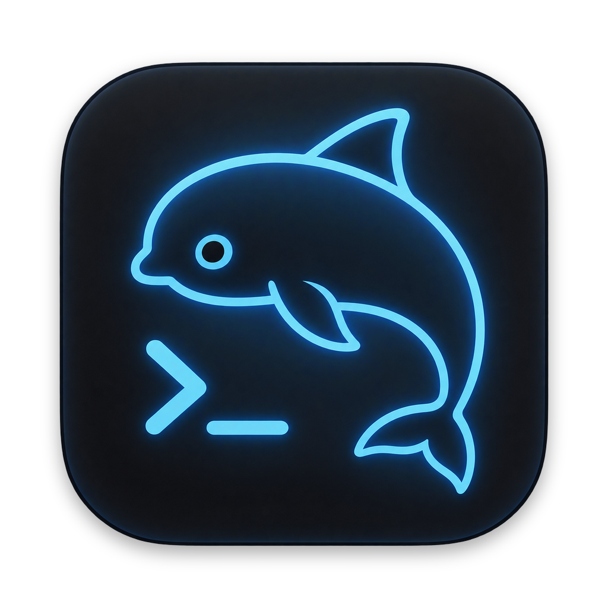
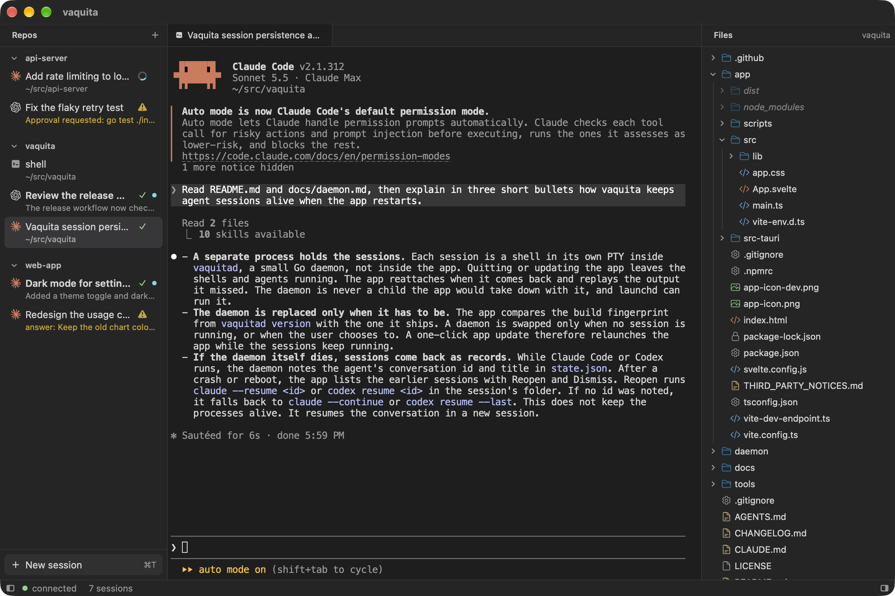

<h1 align="center">
  <br>
  vaquita
</h1>

<p align="center">
  <strong>A lightweight ADE for Claude Code and Codex on macOS.</strong><br>
  Every agent in one sidebar: working, waiting for you, or done. No hooks.
</p>

<p align="center">
  <a href="https://github.com/zeikar/vaquita/releases/latest"></a>
  
  <a href="LICENSE"></a>
</p>

vaquita is a lightweight ADE (agentic development environment) for macOS. It runs AI coding agents such as [Claude Code](https://code.claude.com) and [Codex CLI](https://github.com/openai/codex) side by side in the repos they work on: a Tauri app and a Go daemon in a download of about 8 MB, with no hooks to install. Think of it as a smaller take on [Orca](https://www.onorca.dev/), the agent IDE.



## Features

- **Every agent in one sidebar.** Your repos are listed with their sessions under them. Start Claude Code, Codex or a shell in a repo from its header, its right-click menu or ⌘T.
- **See what each agent is doing.** A spinner while it works, ⚠ with the permission or question it waits on, ✓ or ✗ when its turn ends, and a dot until you have looked.
- **Notifications that take you there.** A desktop notification when an agent finishes, fails or needs input; click it to open that session. The ones missed while the app was closed are summed up when it comes back.
- **Sessions outlive the app.** Shells and agents run in a small daemon, `vaquitad`, so quitting or updating the app leaves them running. After a reboot, reopen a session and Claude Code or Codex resumes its conversation.
- **No hooks, no global config.** State comes from what the agents already write to the terminal (Claude Code's OSC 7501 status reports, Codex's notifications), so nothing is written into your agents' settings.
- **Titles that say what a session is about.** A session takes the topic its agent gives the conversation; double-click it to rename.
- **Open the files agents mention.** ⌘-click a path or a file link in the output to open it in a tab inside the app (text, code, Markdown, images, audio and video) or else in its default app. Terminal output is not trusted, so anything that could run something is only shown in Finder.
- **Light.** With 10 or so sessions open, the app, its WebKit processes and the daemon use about 200 MB of memory together, and next to no CPU while idle. The editor loads only when a text file is first opened, and adds about 100 MB from then on ([how it was measured](docs/app.md#footprint)).

## Install

Download `vaquita-<version>-macos-arm64.zip` from [Releases](https://github.com/zeikar/vaquita/releases) (Apple Silicon only), unzip it and move `vaquita.app` to `/Applications`. The app is signed with a self-signed certificate and not notarized, so clear the quarantine flag once (recursive, so the embedded daemon is covered too):

```sh
xattr -dr com.apple.quarantine /Applications/vaquita.app
```

The app installs and starts its daemon by itself. It runs the `claude` and `codex` you already have; it does not bundle them. Releases after 0.1.3 update themselves: when a newer release is out, a notice in the app offers it, and one click installs it and relaunches the app while your sessions keep running; the app takes care of the daemon ([how updates work](docs/app.md#updates)). To update by hand, as you need to once from 0.1.3 or earlier, quit vaquita, replace the app in Finder and open it. Don't `cp -R` over the app while the daemon runs.

vaquita is young (0.1.x) and macOS only. Issues and ideas are welcome.

## Develop

A dev instance keeps its own home, so a stable install is untouched:

```sh
export VAQUITA_HOME=~/.vaquita-dev PATH=~/.vaquita-dev/bin:$PATH
make -C daemon
vaquitad serve --allow-origin http://localhost:1420
# in another terminal, after the same export, in app/
npm ci
PATH="/opt/homebrew/opt/rustup/bin:$PATH" npm run tauri dev
```

## Docs

- [Daemon](docs/daemon.md): `vaquitad` commands, Codex notifications, reopening sessions after a restart.
- [App](docs/app.md): the dev loop, what the app does, release builds, the icon and the screenshot.
- [tools/probe](docs/probe.md): the recorders and test beds used to check the risky parts.

## License

[MIT](LICENSE)
